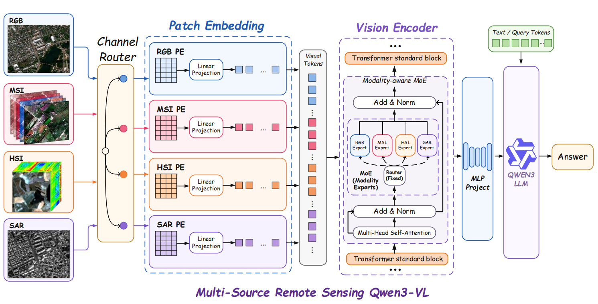

# Zhimu-1.0

<p align="center">
  <b>A unified vision-language model for RGB, SAR, multispectral, and hyperspectral remote-sensing imagery</b>
</p>

> **Model weights:** [AIR-CAS-kx/Zhimu-1.0](https://huggingface.co/AIR-CAS-kx/Zhimu-1.0)  
> **Inference code:** this GitHub repository

## Overview
<p align="center">

</p>
Zhimu-1.0 is a remote-sensing multimodal large language model built on Qwen3-VL. Its vision encoder is adapted to process four remote-sensing modalities within a unified framework:

- RGB imagery
- Synthetic Aperture Radar (SAR)
- Multispectral imagery (MSI)
- Hyperspectral imagery (HSI)

The released model uses modality-specific patch embedding branches and modality-specific visual MoE expert branches. The current checkpoint supports the following default input configurations:

| Modality | CLI value | Default channels | Recommended formats |
|---|---|---:|---|
| RGB | `rgb` | 3 | `.jpg`, `.jpeg`, `.png`, `.tif` |
| SAR | `sar` | 1 | `.npy`, `.npz`, `.tif`, `.tiff`, grayscale images |
| Multispectral | `multispectral` | 12 | `.npy`, `.npz`, `.tif`, `.tiff` |
| Hyperspectral | `hyperspectral` | 218 | `.npy`, `.npz`, `.tif`, `.tiff` |

The channel counts above correspond to the released model configuration. Inputs with other channel counts require a matching patch embedding branch in the model configuration and weights.

## Release Structure

The GitHub repository contains the public inference script:

```text
AIR-CAS-zhimu/
├── README.md
└── test.py
└── requirements.txt
└── examples
└── overview.png
```

The Hugging Face model repository contains the complete local model package:

```text
Zhimu-1.0/
├── config.json
├── configuration_qwen3_vl.py
├── modeling_qwen3_vl.py
├── image_processing_qwen2_vl.py
├── preprocessor_config.json
├── processor_config.json
├── tokenizer.json
├── tokenizer_config.json
├── generation_config.json
├── model.safetensors.index.json
├── model-00001-of-00004.safetensors
├── model-00002-of-00004.safetensors
├── model-00003-of-00004.safetensors
└── model-00004-of-00004.safetensors
```

Some tokenizer or processor files may vary slightly depending on the final Hugging Face release. Always download the complete model repository rather than downloading only the weight shards.

## Installation

### 1. Clone the inference repository

```bash
git clone https://github.com/wangdianyu954-xixi/AIR-CAS-zhimu.git
cd AIR-CAS-zhimu
```

### 2. Create a Python environment

```bash
conda create -n zhimu python=3.11 -y
conda activate zhimu
```

Install a PyTorch build compatible with your GPU and CUDA environment first. Then install the remaining dependencies:

```bash
pip install \
  "transformers==4.57.6" \
  "huggingface-hub>=0.34.0,<1.0" \
  accelerate \
  safetensors \
  numpy \
  pillow \
  tifffile \
  scipy
```

The model has been tested with:

```text
Python       3.11.11
PyTorch      2.10.0+cu128
Transformers 4.57.6
CUDA         12.8
```

Other compatible environments may also work.

## Download the Model

Install or update the Hugging Face Hub CLI:

```bash
pip install "huggingface-hub>=0.34.0,<1.0"
```

Download the complete model repository:

```bash
hf download AIR-CAS-kx/Zhimu-1.0 \
  --local-dir ./Zhimu-1.0
```

For a private or gated repository, authenticate first:

```bash
hf auth login
```

The inference script loads all model files from the local directory. After the download is complete, inference can run without accessing the Hugging Face Hub.

## Quick Start

General command:

```bash
CUDA_VISIBLE_DEVICES=0 python test.py \
  --model-dir /path/to/Zhimu-1.0 \
  --input /path/to/input \
  --modality MODALITY \
  --prompt "Your question" \
  --max-new-tokens 128
```

Supported values for `--modality` are:

```text
rgb
sar
multispectral
hyperspectral
```

### RGB inference

```bash
CUDA_VISIBLE_DEVICES=0 python test.py \
  --model-dir ./Zhimu-1.0 \
  --input ./examples/rgb.jpg \
  --modality rgb \
  --prompt "Classify the given image in one of the following classes. Classes: palace, beach, dense residential, ground track field, medium residential, railway, harbor, sea ice, desert, chaparral. \nAnswer in one word or a short phrase." \
  --max-new-tokens 128
```

### SAR inference

```bash
CUDA_VISIBLE_DEVICES=0 python test.py \
  --model-dir ./Zhimu-1.0 \
  --input ./examples/sar.npy \
  --modality sar \
  --prompt "Locate all targets in this SAR image. Valid labels: ship, aircraft, car, tank, bridge, harbor. Output a JSON array, where each item has \"bbox_2d\" and \"label\"." \
  --max-new-tokens 128
```

A two-dimensional SAR array with shape `(H, W)` is automatically converted to `(1, H, W)`.

### Multispectral inference

```bash
CUDA_VISIBLE_DEVICES=0 python test.py \
  --model-dir ./Zhimu-1.0 \
  --input ./examples/multispectral.tif \
  --modality multispectral \
  --prompt "What is the shape of the road in the image?" \
  --max-new-tokens 128
```

The released multispectral branch expects 12 channels by default.

### Hyperspectral inference

```bash
CUDA_VISIBLE_DEVICES=0 python test.py \
  --model-dir ./Zhimu-1.0 \
  --input ./examples/hyperspectral.npy \
  --modality hyperspectral \
  --prompt "What is the correct level3 land-cover class for this remote sensing image? Choose the best answer from the options below and reply with the option letter and class name only.\n\nA. durum_hard_wheat\nB. lentils\nC. pasture_meadow_grassland_grass\nD. triticale" \
  --max-new-tokens 128
```

The released hyperspectral branch expects 218 channels by default.

## Input Conventions

### RGB

RGB files are loaded with PIL and converted to three-channel RGB images.

### SAR, MSI, and HSI

Non-RGB inputs may be provided as either:

```text
(C, H, W)
(H, W, C)
```

By default, `test.py` automatically identifies the channel axis using the expected channel count. The layout can also be specified explicitly:

```bash
--input-layout chw
```

or:

```bash
--input-layout hwc
```

For example:

```bash
python test.py \
  --model-dir ./Zhimu-1.0 \
  --input ./examples/multispectral.npy \
  --modality multispectral \
  --input-layout chw \
  --prompt "Describe this image."
```

### NPZ files

If an `.npz` file contains multiple arrays, specify the required key:

```bash
--npz-key image
```


### Custom channel counts

The default channel count can be overridden with:

```bash
--expected-channels N
```

This option should only be used when the downloaded checkpoint contains a matching patch embedding branch for `N` channels.

## Command-Line Arguments

| Argument | Required | Description |
|---|---:|---|
| `--model-dir` | Yes | Local directory containing the complete model repository |
| `--input` | Yes | Path to the input image or array |
| `--modality` | Yes | `rgb`, `sar`, `multispectral`, or `hyperspectral` |
| `--prompt` | No | User question; a modality-specific prompt is used by default |
| `--expected-channels` | No | Override the default channel count |
| `--input-layout` | No | `auto`, `chw`, or `hwc` |
| `--npz-key` | No | Array key for an NPZ file |
| `--mat-key` | No | Variable name for a MAT file |
| `--max-new-tokens` | No | Maximum number of generated tokens; default: `128` |
| `--attn` | No | Attention implementation: `sdpa` or `eager` |
| `--dtype` | No | `auto`, `bf16`, `fp16`, or `fp32` |
| `--no-strict-branch-check` | No | Warn instead of failing when the patch embedding branch check fails |

## What the Test Script Validates

The public test script performs the following checks before and during inference:

1. Verifies that the local model directory contains the required files and weight shards.
2. Explicitly imports the custom local model implementation.
3. Explicitly loads the custom multichannel image processor.
4. Converts non-RGB inputs to channels-first format when necessary.
5. Verifies the processor-provided channel count.
6. Verifies the flattened patch dimension.
7. Uses forward hooks to confirm the expected patch embedding branch.
8. Runs deterministic text generation with `do_sample=False`.
9. Reports the generated answer and GPU memory usage.


## Troubleshooting

### `huggingface-hub` version conflict

An error similar to the following indicates an incompatible Hub package:

```text
huggingface-hub>=0.34.0,<1.0 is required
```

Reinstall a compatible version:

```bash
pip install --force-reinstall "huggingface-hub>=0.34.0,<1.0"
```

### Missing TIFF support

```bash
pip install tifffile
```


### CUDA out of memory

Try the following:

```bash
--dtype bf16
```

Reduce the input image resolution or shorten `--max-new-tokens`. Ensure that no unrelated process is occupying GPU memory.

### Channel mismatch

Check the input array shape:

```python
import numpy as np

array = np.load("input.npy")
print(array.shape)
```

Then specify the correct layout:

```bash
--input-layout chw
```

or:

```bash
--input-layout hwc
```

The expected channel count must match the selected modality and the released checkpoint.

### Incorrect model class or image processor

Download the complete Hugging Face repository again. The model depends on the custom files:

```text
configuration_qwen3_vl.py
modeling_qwen3_vl.py
image_processing_qwen2_vl.py
```

Downloading only the `.safetensors` files is insufficient.

## Limitations

- The released checkpoint currently uses fixed default channel configurations for MSI and HSI.
- Performance may vary across sensors, spatial resolutions, geographic regions, acquisition conditions, and preprocessing pipelines.
- The model may generate inaccurate descriptions or hallucinated details.
- Model outputs should be verified before use in scientific, operational, or safety-critical applications.
- This release is intended primarily for research and evaluation.

## Citation

Citation information will be added after the associated paper or technical report is publicly available.

## License

Please refer to the `LICENSE` file in this repository and the license terms of the upstream Qwen3-VL model. Model users are responsible for complying with all applicable licenses and usage restrictions.

## Acknowledgements

This project is built upon:

- [Qwen3-VL](https://github.com/QwenLM/Qwen3-VL)
- [Hugging Face Transformers](https://github.com/huggingface/transformers)
- [Hugging Face Hub](https://huggingface.co/)

We thank the open-source community for making this work possible.
